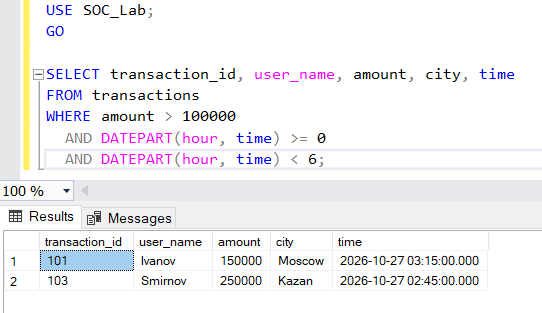

# 🗄️ SQL Database Portfolio (T-SQL)

Репозиторий с практическими примерами работы с реляционными базами данных. Демонстрирует навыки проектирования БД, написания сложных запросов и использования SQL для анализа данных и расследования инцидентов кибербезопасности.

## 🛠️ Технологический стек
*   **СУБД:** Microsoft SQL Server
*   **Язык запросов:** T-SQL
*   **Инструменты:** SQL Server Management Studio (SSMS)

## 🎯 Ключевые навыки, продемонстрированные в коде
*   **DDL (Data Definition Language):** Создание баз данных и таблиц, настройка первичных ключей (`PRIMARY KEY`) и типов данных.
*   **DML (Data Manipulation Language):** Вставка тестовых данных (`INSERT`), очистка таблиц (`DROP TABLE`).
*   **Аналитика и агрегация:** Использование `GROUP BY`, `HAVING`, `COUNT` для поиска аномалий.
*   **Фильтрация данных:** Работа с датами через `DATEPART` и фильтрация по условиям (`WHERE`).
*   **Применение в ИБ:** Написание запросов для поиска брутфорса (Brute-force) и выявления мошеннических транзакций (Антифрод).

## 📂 Что находится в репозитории
В файле **[`security_queries.sql`](./security_queries.sql)** находится полностью готовый к запуску скрипт-полигон. Он включает в себя:
1.  Создание базы данных `SOC_Lab`.
2.  Создание таблиц `auth_logs` (логи входов) и `transactions` (транзакции).
3.  Генерацию тестовых данных, имитирующих инциденты.
4.  **Два аналитических запроса:**
    *   Поиск IP-адресов, с которых было более 10 неудачных попыток входа (признак Brute-force).
    *   Поиск крупных переводов (более 100 000 руб.), совершенных в ночное время (правило Anti-Fraud).

## 🚀 Как проверить работу
Вы можете легко воспроизвести результаты:
1.  Откройте Microsoft SQL Server Management Studio (SSMS).
2.  Создайте новый запрос (**New Query**).
3.  Скопируйте и вставьте весь код из файла `security_queries.sql`.
4.  Нажмите **Execute (F5)**.
5.  В окне результатов вы увидите таблицы с выявленными инцидентами.

## 📸 Результат работы
На скриншоте ниже представлен результат выполнения запроса на поиск подозрительных транзакций. Скрипт автоматически отфильтровал безопасные операции и выявил две аномалии (Ivanov и Smirnov), совершенные ночью на крупные суммы.

---
*Скрипты написаны в рамках изучения банковского ИБ и практики анализа данных.*
