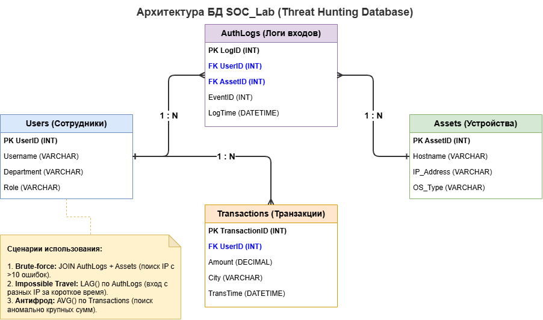
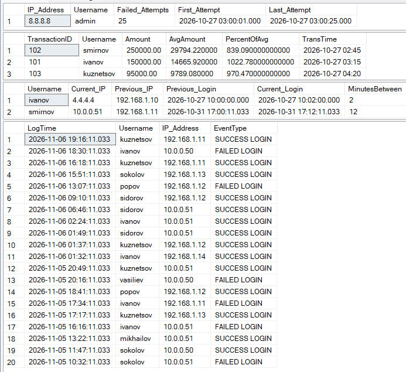

# 🗄️ SQL Database Portfolio (T-SQL)

Репозиторий с практическими примерами работы с реляционными базами данных. Демонстрирует навыки проектирования БД, генерации тестовых данных и написания сложных аналитических запросов для расследования инцидентов кибербезопасности (Threat Hunting).

## 🛠️ Технологический стек
*   **СУБД:** Microsoft SQL Server
*   **Язык запросов:** T-SQL
*   **Инструменты:** SQL Server Management Studio (SSMS)

## 🎯 Ключевые навыки, продемонстрированные в коде
*   **Архитектура БД (DDL):** Создание нормализованных таблиц (`Users`, `Assets`, `AuthLogs`, `Transactions`) с настройкой первичных и внешних ключей (`PRIMARY KEY`, `FOREIGN KEY`).
*   **Генерация данных (DML):** Написание скриптов для автоматического создания 200+ строк реалистичных тестовых данных с использованием `CROSS JOIN` и генераторов случайных чисел (`NEWID()`, `CHECKSUM`).
*   **Продвинутая аналитика:**
    *   Использование **CTE** (Обобщенных табличных выражений) через `WITH`.
    *   Использование **Оконных функций** (`LAG`, `AVG OVER`).
    *   Агрегация и фильтрация групп (`GROUP BY`, `HAVING`).
*   **Применение в ИБ:** Написание запросов для поиска брутфорса (Brute-force), выявления мошеннических транзакций (Антифрод) и детектирования компрометации учетных записей (Impossible Travel).
*   **Представления (Views):** Создание `VIEW` для удобства аналитиков SOC L1.

## 🗄️ Схема базы данных (ER-диаграмма)

Структура учебной БД `SOC_Lab`. Таблицы связаны между собой, что позволяет отслеживать действия пользователей с разных устройств.

## 📂 Что находится в репозитории
В файле **[`security_queries.sql`](./security_queries.sql)** находится полностью готовый к запуску скрипт-полигон. Он включает в себя:
1.  Создание базы данных `SOC_Lab` и 4 связанных таблиц.
2.  Генерацию 200+ записей реалистичного «шума» (успешные и неудачные входы, обычные транзакции).
3.  Симуляцию трех типов кибератак.
4.  **Три аналитических запроса** для их выявления.
5.  Создание `VIEW` для дашборда.

## 🚨 Сценарии расследования (Threat Hunting)

Скрипт демонстрирует выявление следующих инцидентов:

1.  **Брутфорс (Brute-force):** Поиск IP-адресов, с которых производился массовый подбор пароля к привилегированной учетной записи `admin` (более 10 попыток с одного IP).
2.  **Антифрод (Anomaly Detection):** Поиск транзакций, которые превышают средний чек пользователя более чем в 5 раз. Выполняется с помощью CTE и оконной функции `AVG()`.
3.  **Невозможные путешествия (Impossible Travel):** Поиск пользователей, которые совершили успешный вход с разных IP-адресов за подозрительно короткое время (менее 15 минут). Реализовано через оконную функцию `LAG()`.

## 📸 Результат работы

*(Скриншоты из SSMS показывают результаты выполнения запросов)*

**1. Выявление аномальных транзакций (Антифрод):**
Запрос показывает транзакцию Смирнова на `250 000` руб., которая составляет **1434%** от его среднего чека, и транзакцию Иванова на `150 000` руб. (**1515%** от среднего чека).

**2. Поиск "Невозможных путешествий" (Impossible Travel):**
Система выявила пользователя `ivanov`, который умудрился зайти с локального IP `192.168.1.10` и через **2 минуты** уже с внешнего IP `4.4.4.4`, что является явным признаком компрометации учетной записи.

## 🚀 Как проверить работу
Вы можете легко воспроизвести результаты:
1.  Откройте Microsoft SQL Server Management Studio (SSMS).
2.  Создайте новый запрос (**New Query**).
3.  Скопируйте и вставьте весь код из файла `security_queries.sql`.
4.  Нажмите **Execute (F5)**.
5.  В окне результатов вы увидите таблицы с выявленными инцидентами.

---
*Скрипты написаны в рамках изучения банковского ИБ и практики анализа данных.*
